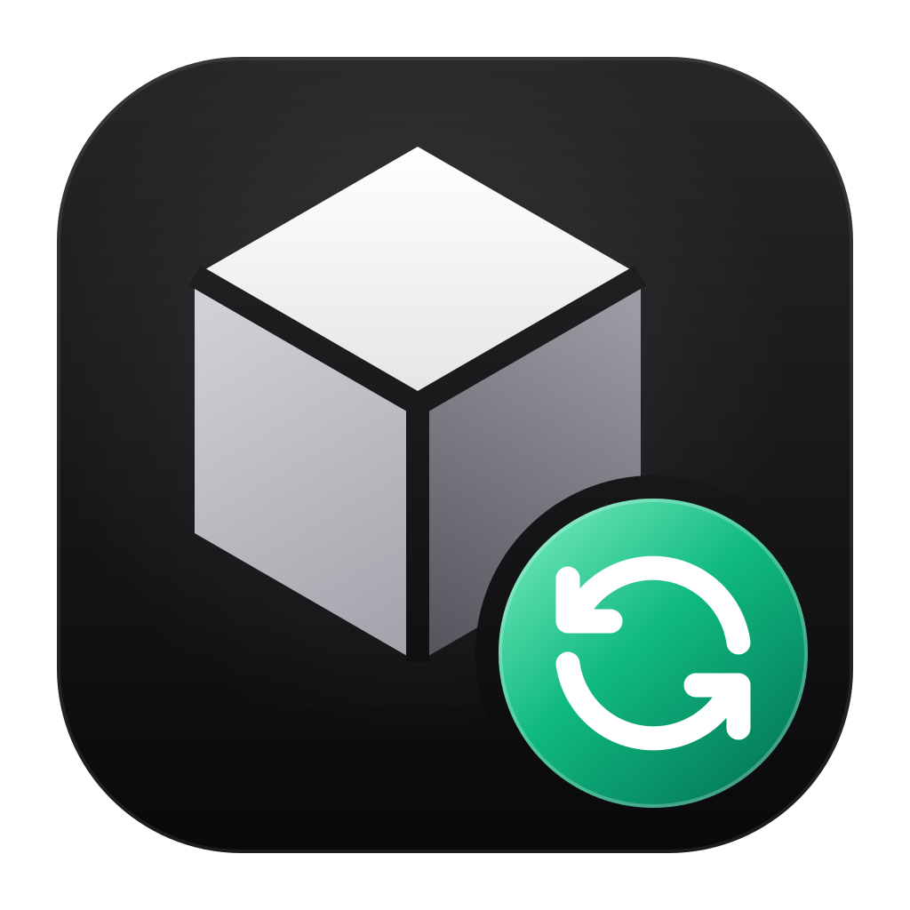
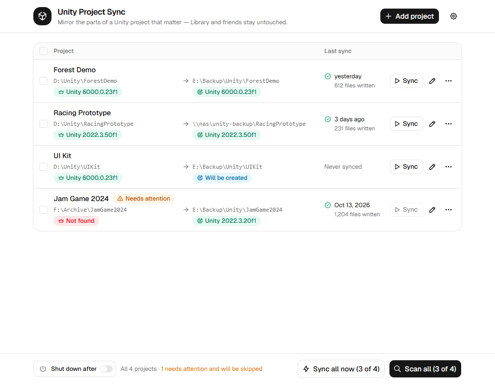
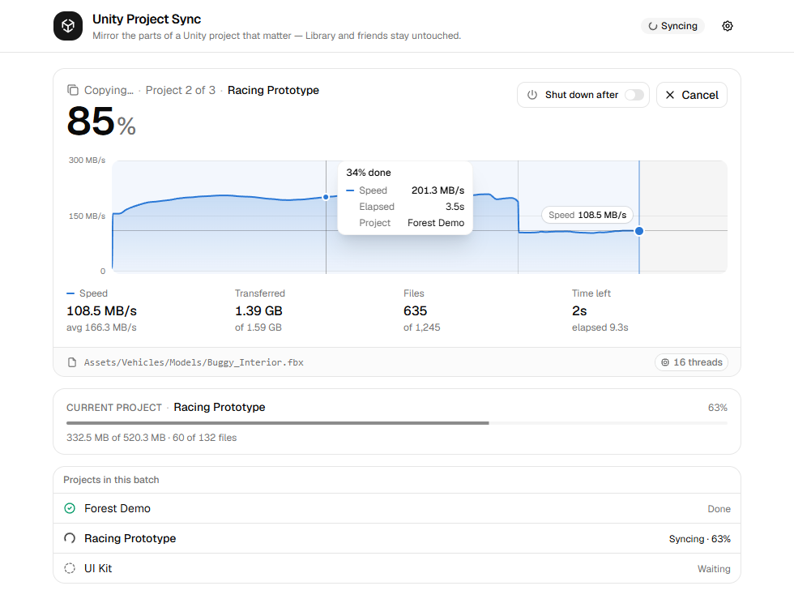
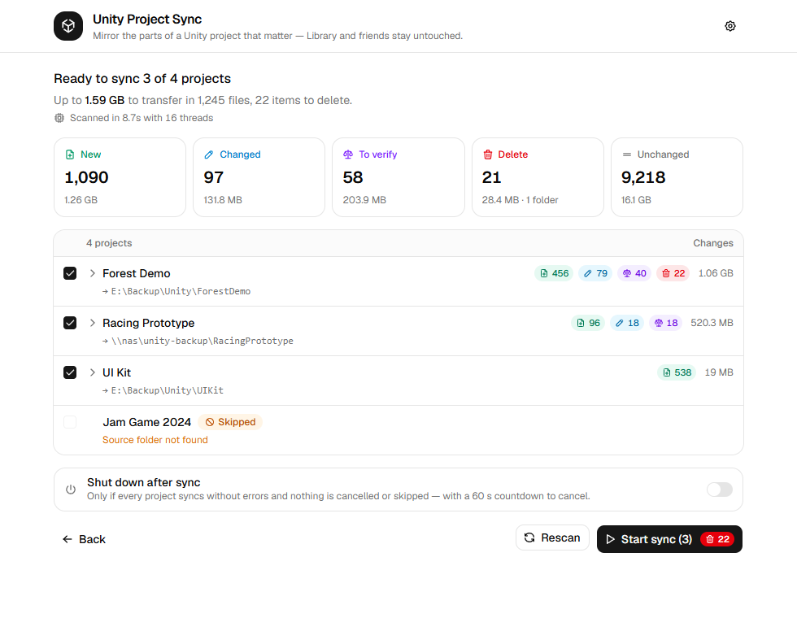
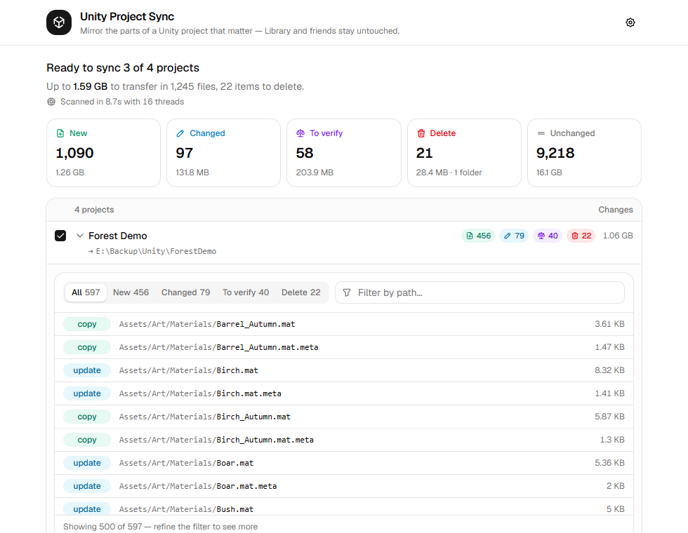
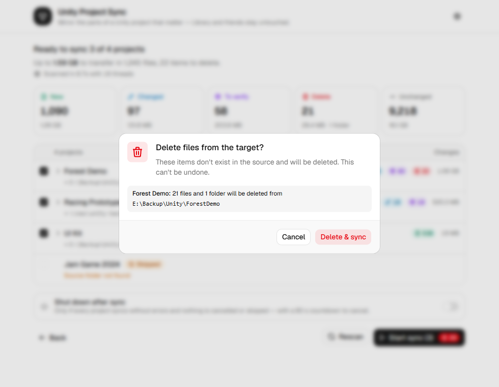
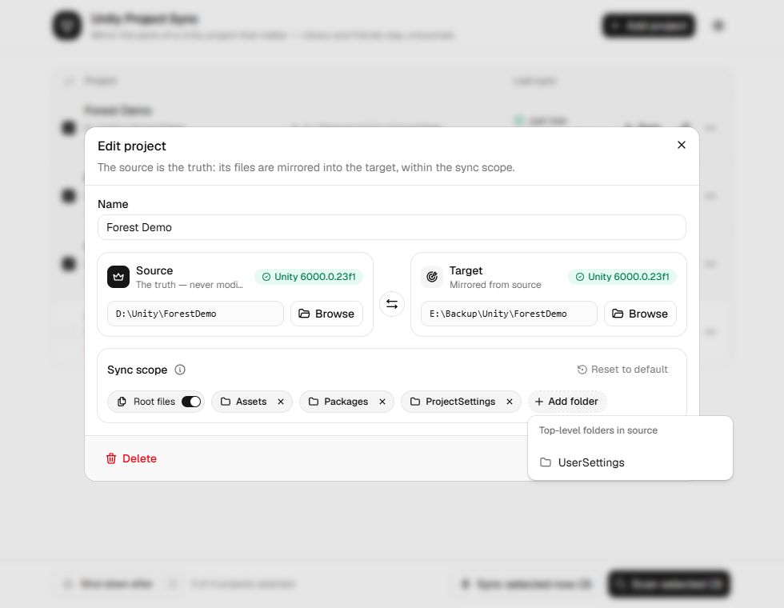
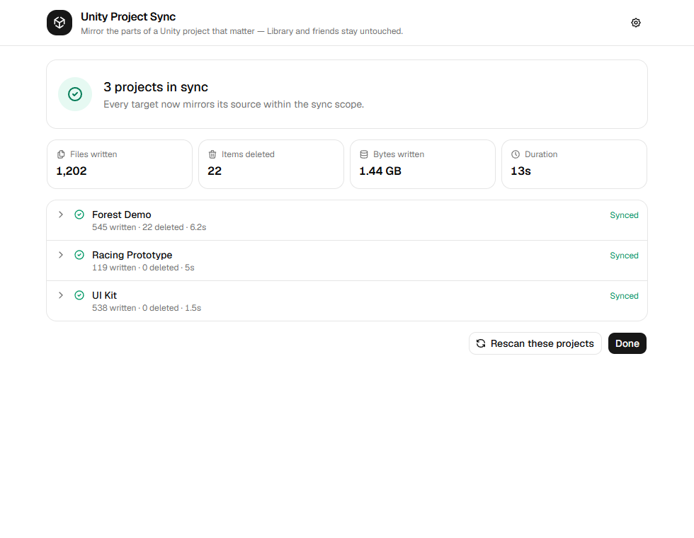
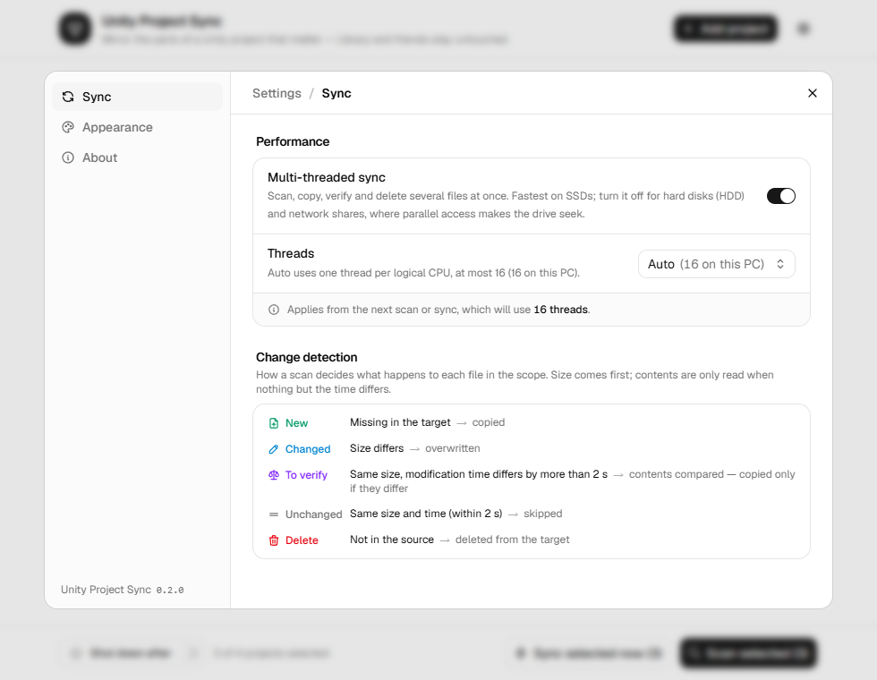

<p align="center">
  
</p>

<h1 align="center">Unity Project Sync</h1>

<p align="center">
  Mirror the non-regenerable parts of Unity projects — <code>Library/</code> and friends stay untouched.
</p>

<p align="center">
  <a href="https://ups.umami-creative.app">Download for Windows</a>
  &nbsp;·&nbsp;
  <a href="#features">Features</a>
  &nbsp;·&nbsp;
  <a href="#development">Development</a>
  &nbsp;·&nbsp;
  <a href="#get-involved">Get involved</a>
  &nbsp;·&nbsp;
  <a href="#license">MIT License</a>
</p>

---

Copying Unity projects between drives, backup folders, or machines is slow and noisy when gigabytes of regenerable `Library/`, `Temp/`, or `.git/` data get dragged along. **Unity Project Sync** is a lightweight desktop app for Windows (built with Tauri 2, Rust, and React) that mirrors only the parts of your Unity projects that actually matter — to another drive, a backup folder or a server share — safely, in parallel, and with a full preview before anything is written or deleted.

> [!NOTE]
> **Not a replacement for version control.** Unity Project Sync keeps no history, can't branch or merge, and doesn't keep older versions: the target simply mirrors the source as it is right now. Keep using Git, Unity Version Control (Plastic SCM) or Perforce for that. This is a helper for one job: getting Unity projects onto another drive or a server share fast and efficiently, without the gigabytes Unity regenerates anyway.

<!-- Screenshots: made with `pnpm demo` (see "Screenshots & demo mode"); they follow GitHub's light/dark theme. -->
<table>
  <tr>
    <td width="50%" align="center" valign="top">
      <a href="update-server/static/screenshots/overview-light.png"><picture><source media="(prefers-color-scheme: dark)" srcset="update-server/static/screenshots/overview-dark.png" /></picture></a>
      <br />
      <em>Project overview: all source → target pairs at a glance, with Unity version detection and pre-flight checks.</em>
    </td>
    <td width="50%" align="center" valign="top">
      <a href="update-server/static/screenshots/transfer-light.png"><picture><source media="(prefers-color-scheme: dark)" srcset="update-server/static/screenshots/transfer-dark.png" /></picture></a>
      <br />
      <em>Transfer: the live throughput chart doubles as the progress bar, with per-project batch status.</em>
    </td>
  </tr>
</table>

<details>
<summary><strong>More screenshots</strong>: scan preview, file list, deletion check, sync scope, report, settings</summary>
<br />
<table>
  <tr>
    <td width="50%" align="center" valign="top">
      <a href="update-server/static/screenshots/preview-light.png"><picture><source media="(prefers-color-scheme: dark)" srcset="update-server/static/screenshots/preview-dark.png" /></picture></a>
      <br />
      <em>Scan preview: one combined summary for the whole batch; untick projects before syncing.</em>
    </td>
    <td width="50%" align="center" valign="top">
      <a href="update-server/static/screenshots/filelist-light.png"><picture><source media="(prefers-color-scheme: dark)" srcset="update-server/static/screenshots/filelist-dark.png" /></picture></a>
      <br />
      <em>File list: every file the sync will copy, update, verify or delete, filterable by action and path.</em>
    </td>
  </tr>
  <tr>
    <td width="50%" align="center" valign="top">
      <a href="update-server/static/screenshots/confirm-light.png"><picture><source media="(prefers-color-scheme: dark)" srcset="update-server/static/screenshots/confirm-dark.png" /></picture></a>
      <br />
      <em>Deletion check: nothing is removed from a target without an explicit confirmation.</em>
    </td>
    <td width="50%" align="center" valign="top">
      <a href="update-server/static/screenshots/editor-light.png"><picture><source media="(prefers-color-scheme: dark)" srcset="update-server/static/screenshots/editor-dark.png" /></picture></a>
      <br />
      <em>Sync scope: per project, with extra top-level folders such as <code>UserSettings/</code>.</em>
    </td>
  </tr>
  <tr>
    <td width="50%" align="center" valign="top">
      <a href="update-server/static/screenshots/report-light.png"><picture><source media="(prefers-color-scheme: dark)" srcset="update-server/static/screenshots/report-dark.png" /></picture></a>
      <br />
      <em>Report: totals for the batch and an expandable summary per project.</em>
    </td>
    <td width="50%" align="center" valign="top">
      <a href="update-server/static/screenshots/settings-light.png"><picture><source media="(prefers-color-scheme: dark)" srcset="update-server/static/screenshots/settings-dark.png" /></picture></a>
      <br />
      <em>Settings: threading for SSDs, HDDs and network shares, plus how change detection works.</em>
    </td>
  </tr>
</table>
</details>

## Download & install

Download the latest Windows (x64) installer from **[ups.umami-creative.app](https://ups.umami-creative.app)**.

- **Single self-contained installer, no admin rights needed.** Installs for the current user into `%LOCALAPPDATA%\Unity Project Sync` with a Start menu entry and standard uninstaller (*Settings → Apps*).
- **WebView2 included.** Windows 11 and up-to-date Windows 10 already include WebView2; if it is missing, the bundled bootstrapper installs it automatically (requires internet access once).
- **Automatic signed updates.** The app checks for updates on startup and in **Settings → About**, verifies the release signature before installing, and preserves all saved projects and settings.
- **Installer language.** Automatically uses English or German based on your Windows display language.
- **SmartScreen notice.** The installer is currently not code-signed, so Windows SmartScreen may show *"Windows protected your PC"*. Click **More info → Run anyway** (you can also verify the SHA-256 checksum listed on the download page).

## Features

### Unity-aware sync scope
- **Sensible defaults:** mirrors loose files in the project root plus `Assets/`, `Packages/`, and `ProjectSettings/`.
- **Customizable per project:** include any additional top-level folders you need (such as `UserSettings/`).
- **Regenerable folders stay off-limits:** `Library/`, `Temp/`, `Logs/`, `obj/`, `.git/`, `.vs/`, and `.utmp/` are never synced or touched on the target.
- **Source is the truth:** files removed from the source are deleted from the target (strictly inside the configured scope), with explicit deletion confirmation per target before running.

### Fast, accurate change detection
- **Size first, content when needed:** files are copied when missing and overwritten when their size, entry type, or letter casing differs.
- **Smart timestamp verification:** when size matches but modification time differs by more than 2 seconds, file contents are compared byte-for-byte. If they turn out identical, only the target's timestamp is refreshed so subsequent scans stay fast.

| Condition | Action |
| --- | --- |
| Missing in target | **Copy** |
| Size, type, or letter casing differs | **Update** |
| Same size, modified time differs by > 2 s | **Verify** (compare contents; copy only if changed) |
| Same size and modified time (within 2 s) | **Skip** |
| Missing in source (inside scope) | **Delete** from target |

### Safe, cancellable transfers
- **Atomic writes:** every file is written to a temporary `*.ups-tmp` file first and renamed into place only after the write completes.
- **Symlink-safe:** symbolic links and Windows junctions are never followed.
- **Cancel anytime:** stop a scan or sync at any point, including in the middle of copying a large file.

### Multi-project workspace & batch syncing
- **Saved project list:** keep all your source → target pairs in one place, each with its own sync scope, detected Unity editor version, live folder status, and last-sync summary (time, outcome, files written, errors).
- **Single or batch runs:** sync an individual project, pick a subset, or run them all in sequence.
- **Combined preview:** **Scan** checks every chosen project and presents one combined summary with totals and an expandable per-project file list. Untick projects before starting, or use **Sync now** to run immediately.
- **Pre-flight safety checks:** catches missing or non-Unity sources, overlapping paths, empty scopes, unconfirmed non-Unity targets, and conflicting targets in the same batch (and warns when one project's source is another's target).
- **Resilient batches:** if one project fails, the remaining projects in the batch still finish, and the final report records every project's outcome.

### Live transfer chart & progress
- **Windows-style transfer card:** the real-time throughput chart doubles as the progress bar, displaying overall completion, current and average speed, bytes and files transferred, per-project status, and ETA.
- **Interactive inspection:** hover or focus the chart and use the arrow keys to read throughput, elapsed time, and active project at any point in the run.
- **At-a-glance status:** overall completion percentage is shown directly in the window title.

### Performance tuning, themes & power options
- **Configurable threading:** scanning, copying, verifying, and deleting run in parallel (`Auto` scales up to 16 threads, or choose a fixed count up to 32). Switch multi-threading off for spinning hard disks (HDDs) or network shares to avoid seek contention.
- **Shut down after sync:** opt-in per run (never persisted) with a cancellable 60-second countdown. Only triggers if every chosen project completes with zero errors, skips, or cancellations.
- **Themes:** choose **System** (follows Windows light/dark changes automatically), **Light**, or **Dark**.

---

## Development

Unity Project Sync is built with [Tauri 2](https://v2.tauri.app/), [Rust](https://www.rust-lang.org/), [React 19](https://react.dev/), [TypeScript](https://www.typescriptlang.org/), [Tailwind CSS v4](https://tailwindcss.com/), [shadcn/ui](https://ui.shadcn.com/), and [Tabler Icons](https://tabler.io/icons).

### Prerequisites

- **Node.js** and **[pnpm](https://pnpm.io/)**
- **Rust** toolchain (`rustup` / `cargo`)
- **[Tauri 2 system prerequisites](https://v2.tauri.app/start/prerequisites/)** (on Windows: Microsoft C++ Build Tools and WebView2)

### Common commands

```powershell
pnpm install                            # install frontend dependencies
pnpm tauri dev                          # run the desktop app in development mode
pnpm demo                               # UI in the browser with demo data (see below)
pnpm build                              # type-check and build the frontend
pnpm test                               # run frontend unit tests (Vitest)
cd src-tauri; cargo test                # run Rust sync engine tests
pnpm tauri build                        # build an unsigned NSIS release installer
```

`pnpm tauri build` outputs a single self-contained installer at:

```text
src-tauri\target\release\bundle\nsis\Unity Project Sync_<version>_x64-setup.exe
```

### Debug throughput throttle

To observe the transfer speed chart on a fast NVMe/SSD during development, set `UPS_DEBUG_THROTTLE_MBPS` (in MiB/s) before starting `pnpm tauri dev`. It caps total copy/verify throughput across all workers and is only compiled into debug builds (`#[cfg(debug_assertions)]`, ignored by release builds and `cargo test`):

```powershell
$env:UPS_DEBUG_THROTTLE_MBPS = "40"; pnpm tauri dev; Remove-Item env:UPS_DEBUG_THROTTLE_MBPS
```

### Screenshots & demo mode

`pnpm demo` runs the UI in a normal browser at <http://localhost:1430/?shots> against a simulated backend (`src/demo/`): four demo projects, scans and batch syncs with realistic file lists and transfer speeds, all deterministic. Only `vite --mode demo` swaps the Tauri modules for the stand-ins, so `pnpm tauri dev` and release builds never contain it.

- `?shots` hides scrollbars; `?speed=4` runs the simulation 4× faster.
- In the browser console, `upsDemo.pauseAt("Racing Prototype", 0.62)` freezes the next sync at 62 % of that project (`upsDemo.pause()` / `upsDemo.resume()` work any time), e.g. to hover the speed chart for a screenshot.
- The README and the download page use the screenshots in `update-server/static/screenshots/` (`<screen>-light.png` / `<screen>-dark.png`, 980 × 760 like the app window). The page embeds the ones listed in `update-server/src/assets.rs`.

### Repository layout

- `src/` — React UI, hooks, and pure frontend state/validation logic:
  - `src/lib/types.ts` — shared TypeScript contract (mirrored by `src-tauri/src/model.rs`)
  - `src/lib/projects.ts` — naming, validation, and cross-project conflict checks
  - `src/lib/batch.ts` — batch state machine, progress/ETA, outcomes, and shutdown rules
  - `src/lib/speed-history.ts` — binned speed history backing the transfer chart
  - `src/lib/store.ts` — persistence and settings migration
  - `src/hooks/use-batch-runner.ts` — sequential scan/sync orchestration and cancellation
  - `src/demo/` — demo data and simulated backend for `pnpm demo` (never in app builds)
- `src-tauri/src/` — Rust backend and sync engine:
  - `model.rs` — serde types shared with the frontend
  - `project.rs` — folder inspection and Unity version detection
  - `scan.rs` — parallel directory walk and diff planner
  - `sync.rs` — parallel transfer executor, atomic writes, content verification, and progress reporting
  - `shutdown.rs` — system shutdown integration
- `update-server/` — standalone Rust (axum) update server and download landing page (see [`update-server/README.md`](update-server/README.md))
- `scripts/release.ps1` — builds and stages signed releases for the update server

### Releases & updates

Plain `pnpm tauri build` runs produce unsigned installers and do not require a signing key. Signed updater builds use `src-tauri/tauri.release.conf.json` (`createUpdaterArtifacts`) and verify against the minisign public key configured in `src-tauri/tauri.conf.json` (`plugins.updater.pubkey`).

Maintainers can build and stage a signed release with `scripts/release.ps1` (using a local minisign private key at `%USERPROFILE%\.tauri\unity-project-sync.key`, which is never committed; set `$env:TAURI_SIGNING_PRIVATE_KEY_PASSWORD` if password-protected):

```powershell
scripts\release.ps1 -Version 0.2.0 -NotesFile notes.md
```

This bumps the version across `src-tauri/tauri.conf.json`, `package.json`, and `src-tauri/Cargo.toml`, builds the signed installer, and writes `release\<version>\` containing the installer and `release.json`. Useful flags: `-Notes "..."` for inline notes, `-SkipBuild` to restage the last signed build, `-Upload` to copy via `scp` when `$env:UPS_UPLOAD_TARGET` is set, and `-Force` only for versions that have not been published yet.

For running or self-hosting the update server and download page locally or with Docker, see [`update-server/README.md`](update-server/README.md):

```powershell
cd update-server; $env:RELEASES_DIR = "..\release"; cargo run   # http://localhost:8080
cd update-server; cargo test
```

---

## Get involved

Contributions, bug reports, and feature ideas are welcome!

- **Found a bug or have an idea?** Open an issue on [GitHub Issues](https://github.com/Umami-Creative-GmbH/unity-project-sync/issues) with steps to reproduce, your Windows version, and what you expected to happen.
- **Want to contribute code?**
  1. Fork the repository and create a branch for your change.
  2. For larger features or architectural changes, open an issue first so we can align on the approach.
  3. Make sure the frontend builds and all tests pass before opening a pull request:
     ```powershell
     pnpm build
     pnpm test
     cd src-tauri; cargo test
     ```
  4. Open a [Pull Request](https://github.com/Umami-Creative-GmbH/unity-project-sync/pulls) with a clear description of what changed and why.

## License

Copyright © 2026 Umami Creative GmbH. Licensed under the **MIT License**.
